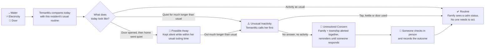
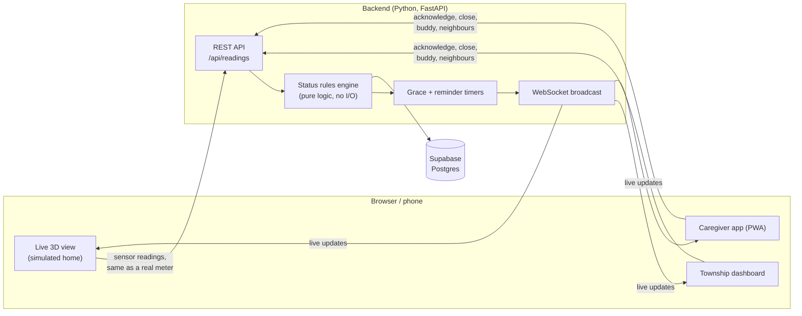

# TemanMu

**Reassurance at home. Connection in the community.**

TemanMu ("your friend" in Malay) looks after older people who live alone, using only the water, electricity and front-door activity in their home. There are no cameras, no wristbands, and no app for the older person to learn.

If their usual routine suddenly stops, TemanMu gets a real person to check on them quickly. On ordinary days, it sends the family a calm "Mum's day has started" message and helps the resident meet people nearby.

> Built by team **Albert & Einstein** (Universiti Malaya) for the **Sime Darby Property Township of Tomorrow 2026** hackathon.

| | |
| --- | --- |
| 🎬 **Pitch slides** | `/slides` in the running app |
| 🧪 **Try the prototype** | [Run it in 2 minutes](#try-it-in-2-minutes-no-backend-needed), no database needed |
| 📄 **Product requirements** | [temanmu-prd.md](temanmu-prd.md) |
| ❓ **FAQ** | [faq.md](faq.md) |

---

## Contents

1. [TemanMu in one minute](#temanmu-in-one-minute)
2. [The problem](#the-problem)
3. [Who it is for](#who-it-is-for)
4. [Our solution](#our-solution)
5. [How it works](#how-it-works)
6. [What makes TemanMu different](#what-makes-temanmu-different)
7. [Privacy and safety by design](#privacy-and-safety-by-design)
8. [The prototype: what you can see and try](#the-prototype-what-you-can-see-and-try)
9. [What is real and what is simulated](#what-is-real-and-what-is-simulated)
10. [How it is built](#how-it-is-built)
11. [Run it yourself](#run-it-yourself)
12. [Tests](#tests)
13. [Impact and pilot plan](#impact-and-pilot-plan)
14. [FAQ](#faq)
15. [Team](#team)
16. [Credits and sources](#credits-and-sources)

---

## TemanMu in one minute

- **The worry.** When an older person living alone falls or becomes unwell, nobody may notice for hours or even days.
- **The idea.** Everyone uses water and electricity every day. If those everyday signals go quiet for much longer than usual, something may be wrong.
- **What TemanMu does.**
  1. Learns each resident's normal daily rhythm from their water, electricity and door activity.
  2. Notices when today looks very different, for example no water used for far longer than usual.
  3. Calls the resident first. If they use the tap or kettle, or answer, the alert is cancelled and nobody is bothered.
  4. If there is still no sign of activity, it alerts **both the family and the township guard at the same time**, and keeps reminding them until someone says "I'll check now".
  5. Whoever checks records what happened, so every alert ends with an accountable outcome.
- **Beyond emergencies.** Families receive a daily reassurance message, can see a simple timeline of Mum's day, and can connect her with a volunteer **Community Buddy** or a **neighbour who keeps similar hours**.
- **What the older person has to do: nothing.** Living their normal day is all it takes.

---

## The problem

**When someone lives alone, silence is ambiguous.** A quiet house could mean they are asleep, out, or lying on the floor needing help.

Malaysia is ageing quickly, and more older people now live on their own:

| Finding (Malaysians aged 60+) | Figure |
| --- | --- |
| Lived alone in 2018 | **6.3%** |
| Lived alone in 2025 | **18.8%**, nearly 3× in seven years |
| Reported poor social support | **33.1%** |
| Had a fall in the previous 12 months | **14.1%** |
| Had a limitation in basic daily activities | **17.0%** |

Sources: National Health and Morbidity Survey (NHMS) 2018 and 2025. Links are in [Credits and sources](#credits-and-sources).

**Today's options each have a catch:**

| Option | The catch |
| --- | --- |
| Cameras / CCTV | Feel intrusive inside a private home, and only see the spaces they cover |
| Wearables (watches, pendants, alarm buttons) | Must be worn, charged and pressed. They are often forgotten or taken off in the bathroom, where many falls happen |
| Dedicated motion sensors | Extra hardware in every room, tracking every movement |
| Simple water-meter alerts | One fixed rule for everyone causes false alarms, and there is often no clear plan for who goes to check |

Two more gaps make this worse:

- **Families often live far away.** A daughter in another city either calls anxiously every day, or hears nothing until something goes wrong.
- **Living alone often means being isolated.** A resident may share a block with hundreds of neighbours and know none of them.

**Our question:** can everyday household signals tell us when something is wrong, and get the right person to help, without watching the person?

---

## Who it is for

| Person | What they need | What TemanMu gives them |
| --- | --- | --- |
| **Older resident** (e.g. Madam Lee, 70s, lives alone) | Independence, privacy and human connection | Nothing to wear, charge or press. Their normal routine quietly confirms they are fine. Opt-in buddies and neighbour introductions |
| **Family caregiver** (e.g. her daughter Sarah) | Daily reassurance and a clear path to action | A morning "Mum's day has started" message, a timeline of Mum's day, alerts only when it matters, and buttons to respond |
| **Township operator / guard** (e.g. Guard Ali) | To know which homes need attention right now | One dashboard for the whole block, highlighting only the homes that need a response, with a step-by-step incident record |
| **Township developer** (Sime Darby Property) | Townships that attract multigenerational families | A care service that strengthens township appeal and resident engagement, and can scale across developments |

---

## Our solution

TemanMu has two parts.

### 1. Safety: notice when a routine breaks

TemanMu reads three everyday household signals:

| Signal | Everyday example | What it tells TemanMu |
| --- | --- | --- |
| 💧 **Water meter** | Tap, shower, toilet | **The main sign of life.** If water stays unused much longer than this resident usually goes without it, TemanMu starts to check |
| ⚡ **Electricity meter** | Kettle, TV, lamp | **Confirms someone is home and active.** Any use cancels a pending check |
| 🚪 **Front-door sensor** | Door opens and closes | **Marks a possible outing**, so an empty home is not mistaken for an emergency |

It learns **each resident's own routine** over the first few weeks: when they usually wake, how long their home is normally quiet (for example during an afternoon nap), and how long they are usually out. A late riser or a daily walker will not trigger false alarms, because alerts compare today with *their* normal, not a fixed rule like "no movement for 12 hours".

### 2. Companion: support on ordinary days

Most days nothing goes wrong, and TemanMu is still useful:

- **Morning reassurance.** The family gets "Mum's day has started" when the first water or electricity use of the day is seen.
- **Mum's day at a glance.** A 24-hour timeline of water, power and door activity, with nothing more detailed than that.
- **Community activities.** The family can see what is happening nearby (gardening, tai chi, cooking classes) and invite Mum or join her.
- **Community Buddy.** The family can request a local volunteer who shares Mum's interests, for example a gardening buddy.
- **Same-hour neighbours.** With consent from both sides, TemanMu suggests a neighbour whose day naturally crosses Mum's ("Both early risers who head out in the mornings"). A community coordinator makes the introduction in person, and **no one's exact times are ever revealed**.

The resident stays tech-free. The family acts on their behalf, and anything that reaches the resident arrives through a real person.

---

## How it works

**Sensors notice. TemanMu checks. People respond.**



### The four statuses

| Status | When it happens | Who is told |
| --- | --- | --- |
| **Routine** | Normal activity. The first activity of the day triggers the morning reassurance message | The family gets a calm morning message |
| **Possible Away** | The door opened, then no water or electricity use followed. She has probably gone out | Nobody is alarmed. The family can see she may be out and choose to call her |
| **Unusual Inactivity** | Water has been unused for longer than her usual quiet gap, or she has been "away" much longer than her usual outing | Nobody yet. TemanMu starts a short **grace period** and places an automated call to her. Any water, electricity or door activity cancels everything |
| **Unresolved Concern** | The grace period ended with no answer and no activity | **The family and the township guard are alerted at the same time.** Reminders repeat until someone taps **"I'll Check Now"** |

### What happens during an alert

1. **Both are told at once.** The family can check in remotely by phone, or ask the township to visit. The guard can take the in-person visit.
2. **One tap stops the reminders.** When the guard taps "I'll Check Now", everyone sees who is going, so nobody assumes someone else has it handled.
3. **Every case ends with an outcome.** The responder records *Resident OK*, *Assistance provided*, *Sent to hospital* or *Resident was away*, with a short note.
4. **Serious cases cannot be closed by accident.** The guard can record "I called 999" or "I can't verify her safety". A case where safety could not be verified stays open until someone confirms she is OK in person, or an emergency handoff is recorded. TemanMu never calls emergency services by itself. A human always decides.
5. **Families can close false alarms.** If the family speaks to Mum directly and she is fine, they can close the alert so the guard is not sent for nothing.

### Every alert explains itself

Each status comes with a plain-language reason, so operators and families trust what they see. For example:

- *"No water use for 0:34, longer than usual maximum of 0:30. No door event."*
- *"Door opened at 08:02, then no water use and electricity back to standby: probably out."*
- *"Resolved: electricity use detected (kettle on) during grace period."*

---

## What makes TemanMu different

| | What it means | Why it matters |
| --- | --- | --- |
| **1. Effortless for residents** | Water, electricity and door activity provide the clues. Nothing to wear, charge, press or learn | Works for the people who need it most, including those who would never use an app |
| **2. Three signals cross-check** | Water triggers the check. The door explains absences. Electricity confirms she is home and active | Fewer false alarms than single-signal systems. Outings stay silent |
| **3. Personal, not one-size-fits-all** | Limits come from each resident's own history, not a fixed rule for everyone | A late riser or a long napper is not flagged as an emergency |
| **4. Resident first, then family and township together** | An automated call goes to the resident first. If unanswered, family and a nearby township responder are alerted together | Help can arrive in minutes even if the family is far away |
| **5. Accountable from start to finish** | Reminders until someone responds, a named responder, and a recorded outcome | No alert is silently missed, and the township has a clear record |
| **6. More than an alarm** | Daily reassurance, community activities, Community Buddies and same-hour neighbour introductions | Tackles loneliness as well as emergencies, and builds a stronger township community |

---

## Privacy and safety by design

- **No cameras, microphones or wearables.** TemanMu only sees *how much* water and electricity is being used and *whether* the front door opened.
- **Nothing inside the home is tracked room by room.** There is no motion tracking or location inside the home.
- **Neighbour matching never shares times.** The other family only sees a name, a floor and a coarse label such as "early risers". Wake times, outing times and unit numbers are never exposed, because knowing "she leaves at 7 every day" would help a burglar.
- **Consent first.** Neighbour introductions need consent from both residents, can be withdrawn at any time, and are made by a human coordinator.
- **Humans make the decisions.** TemanMu never dispatches anyone or calls 999 automatically. It gets the right people informed, and people decide what to do.
- **Built to avoid false alarms.** Each resident is compared with their own routine, the resident is called first, and any sign of activity cancels the alert.

---

## The prototype: what you can see and try

Real meters are not installed yet, so the prototype includes a **3D simulated home** that stands in for a real one. Clicking the tap, kettle or door in the 3D home sends **exactly the same data a real smart meter would**. Everything after that (status rules, timers, alerts, dashboard and family app) runs live.

### The pages

| Page | Address | Who it represents |
| --- | --- | --- |
| **Landing page** | `/` | Explains TemanMu and links to everything |
| **Live 3D view** (simulator) | `/simulator` | Madam Lee's home (unit A-105), with clickable sensors and one-click scenarios |
| **Township dashboard** | `/dashboard` | Guard Ali's view of Block A: 24 floors, 144 units |
| **Caregiver app** | `/caregiver` | Sarah's phone app. Can be installed on a real phone's home screen |
| **Pitch slides** | `/slides` | Our presentation, which can also be exported to PowerPoint |

All pages share one live state. Open them side by side, or open the caregiver app on your phone. An action in the 3D home appears on the dashboard and in the family app within a second.

<!-- Screenshots: add images to docs/screenshots/ and uncomment.
| Live 3D view | Township dashboard | Caregiver app |
| --- | --- | --- |
|  |  |  |
-->

### The four demo scenarios

Each scenario runs with one click in the Live 3D view. Real-world timings (hours) are shortened to seconds so a full story fits into a few minutes.

| Scenario | What you will see | What it proves |
| --- | --- | --- |
| **1. Normal Morning** | Madam Lee wakes, uses the bathroom tap and boils the kettle. Sarah's phone shows "Mum's day has started" | Daily reassurance, without anyone asking |
| **2. Going Out** | She leaves through the front door and comes back. The home goes quiet, but nobody is alerted | Outings do not cause false alarms |
| **3. Unusual Inactivity** | She collapses (shown for the audience only, not a sensor reading). The quiet-gap bar fills, her phone rings with no answer, then Sarah and Guard Ali are alerted together. Guard Ali walks in to check on her | The full safety response, from first sign to recorded outcome |
| **4. False Alarm Recovery** | It starts like Scenario 3, but during the grace period she gets up and uses the tap | Any sign of activity cancels the alert. Nobody is bothered |

### A suggested 3-minute walkthrough for judges

1. Open `/simulator` in one window and `/dashboard` in another. Open `/caregiver` in a third window or on your phone.
2. In the 3D home, switch to **Sensor view**. Everything dims except the tap, shower, kettle, TV, lamp and door, which is exactly what TemanMu can see.
3. Click the **tap** or **kettle** yourself. Watch the meter panel update, and the morning message arrive in the caregiver app.
4. Play **Unusual Inactivity**. Watch A-105's tile on the dashboard fill up, the phone ring, and both the guard and the family get alerted.
5. On the dashboard, tap **I'll Check Now**, then record an outcome.
6. In the caregiver app, open **Together** and tap **Find a buddy** or **Open to meeting neighbours**.
7. Click **Reset demo** to start fresh.

---

## What is real and what is simulated

We want to be clear about what this first-round prototype does.

| Working for real in the prototype | Simulated or planned for the pilot |
| --- | --- |
| Status rules engine (Routine, Possible Away, Unusual Inactivity, Unresolved Concern) | Smart water/electricity meters and door sensors. **The 3D home stands in for them** |
| Grace-period and reminder timers on the server | The automated call to the resident is shown in the timeline and 3D scene, but no real call is placed |
| Live updates to every open page and device | Each resident's routine baseline is pre-filled. In production it is learned from a few weeks of history |
| Caregiver and township incident workflow with recorded outcomes and 999 handoff record | Community Buddies, activities and neighbour data are sample data. Requests are recorded, but no one is contacted |
| Buddy matching by shared interest, neighbour matching by overlapping routine with consent | Floor 1 (six units) is live. Floors 2–24 on the dashboard are sample data to show scale |
| Installable caregiver phone app (PWA) | No user accounts or login. Everyone shares one demo state |

The backend treats the simulator exactly like hardware, so **real meters can replace the 3D home without changing the backend**.

---

## How it is built



| Layer | Technology |
| --- | --- |
| Frontend (all pages) | React 19, Vite, TypeScript, Tailwind CSS, lucide-react icons |
| Caregiver app | Same frontend, installable as a Progressive Web App (`vite-plugin-pwa`) |
| 3D home | Three.js with React Three Fiber and Drei. Microsoft Rocketbox avatars (MIT) for Madam Lee and Guard Ali |
| Backend | Python 3.11+, FastAPI, run with `uvicorn` as a single worker |
| Real-time updates | FastAPI WebSocket |
| Timers | `asyncio` tasks on the server, so alerts keep running even if every browser is closed |
| Database | Supabase (Postgres), accessed only by the backend |
| Slides | Built into the app, with PowerPoint export (`pptxgenjs`) |

**Design choices worth noting**

- **The rules engine is a pure module** ([backend/app/rules/engine.py](backend/app/rules/engine.py)) with no database or network code. The same logic can run on real meter data later.
- **No hard-coded durations.** Every threshold comes from configuration or the resident's own baseline. Demo timings (15 seconds) and production timings (15 minutes) differ only in `.env`.
- **Shared demo data.** One file, [shared/seed.json](shared/seed.json), feeds both the backend and the frontend's offline mock mode.
- **Works without a backend.** With mock mode on, the frontend runs the same flows in the browser, shared across tabs, so anyone can try it with only Node.js installed.

### Repository layout

```
TemanMu/
├── frontend/                React + Vite app (all pages)
│   └── src/
│       ├── landing/         Landing page
│       ├── dashboard/       Township dashboard and incident response
│       ├── caregiver/       Caregiver phone app (PWA)
│       ├── home/            3D home: rooms, characters, scenarios, sensor gateway
│       ├── slides/          Pitch slides and PowerPoint export
│       ├── api/             REST + WebSocket client and shared store
│       └── mocks/           Offline mock backend (runs in a SharedWorker)
├── backend/                 Python FastAPI service
│   ├── app/
│   │   ├── api/             REST routes
│   │   ├── rules/           Pure status rules engine
│   │   ├── services/        Monitoring, notifications, companion, neighbours, reset
│   │   ├── realtime/        WebSocket broadcast
│   │   ├── db/              Queries and SQL migrations
│   │   └── main.py          App entry point
│   └── tests/               pytest suite
├── shared/seed.json         Demo residents, baselines, buddies and activities
├── temanmu-prd.md           Product requirements (features, rules, API contract)
├── faq.md                   Frequently asked questions
└── deployment-plan.md       Vercel + Google Cloud Run + Supabase deployment
```

---

## Run it yourself

### Try it in 2 minutes (no backend needed)

You only need [Node.js 20+](https://nodejs.org). The app runs with built-in sample data.

```bash
cd frontend
npm install
npm run dev
```

Open http://localhost:5173 and follow the links to the 3D view, dashboard and caregiver app. Open them in separate tabs; they stay in sync.

### Full setup (real backend and database)

This runs the Python backend with a Supabase (Postgres) database, as used in the live demo.

**Prerequisites**

| Tool | macOS / Linux | Windows |
| --- | --- | --- |
| **Python 3.11+** | `python3 --version` (if older, use `python3.11`) | Install from [python.org](https://www.python.org/downloads/windows/) and tick **"Add python.exe to PATH"**. Check with `py --version` |
| **Node.js 20+** and npm | [nodejs.org](https://nodejs.org) or `brew install node` | Install the LTS from [nodejs.org](https://nodejs.org). Check with `node -v` |
| **Git** | usually preinstalled | [git-scm.com](https://git-scm.com/download/win) |

You also need a **Supabase connection string** (team members: ask the team lead). On Windows, use **PowerShell** and run each command on its own line.

#### 1. Backend

**macOS / Linux**

```bash
cd backend
python3.11 -m venv .venv
source .venv/bin/activate
pip install -r requirements.txt
cp .env.example .env
```

**Windows (PowerShell)**

```powershell
cd backend
py -3.11 -m venv .venv
.venv\Scripts\Activate.ps1
pip install -r requirements.txt
copy .env.example .env
```

> If activation fails with *"running scripts is disabled on this system"*, run `Set-ExecutionPolicy -Scope CurrentUser RemoteSigned` once, then activate again (or use `.venv\Scripts\activate.bat` in cmd).

Open `backend/.env` and set `DATABASE_URL` (use the Supabase **session pooler** on port 5432). Everything else can stay at its default:

```env
DATABASE_URL=postgresql://postgres.<ref>:<password>@aws-0-<region>.pooler.supabase.com:5432/postgres
GRACE_PERIOD_SECONDS=15
REMINDER_INTERVAL_SECONDS=15
VOICE_CALL_RING_SECONDS=2
CONTROLLABLE_UNIT_ID=A-105
SEED_FILE=../shared/seed.json
CORS_ORIGINS=http://localhost:5173
DEMO_TIMEZONE=Asia/Kuala_Lumpur
```

Start it (inside `backend/`, with the virtual environment active):

```bash
python -m app.db.migrate                     # create tables (first time only, safe to re-run)
uvicorn app.main:app --port 8000             # single worker, do NOT add --workers
```

In a **second terminal**, load the demo data (this is also what "Reset demo" does):

```bash
# macOS / Linux
curl -X POST localhost:8000/api/demo/reset
```

```powershell
# Windows PowerShell
Invoke-RestMethod -Method Post http://localhost:8000/api/demo/reset
```

Interactive API docs: http://localhost:8000/docs

#### 2. Frontend

```bash
cd frontend
npm install
```

Create `frontend/.env.local` containing one line:

```env
VITE_USE_MOCK=false
```

- `VITE_USE_MOCK=false`: talk to the real backend (needs step 1 running).
- `VITE_USE_MOCK=true`, or no file: built-in sample data, no backend needed.

```bash
# macOS / Linux
echo "VITE_USE_MOCK=false" > .env.local
```

```powershell
# Windows PowerShell (-Encoding ascii matters, the default can write a file Vite can't read)
Set-Content -Path .env.local -Value "VITE_USE_MOCK=false" -Encoding ascii
```

Then run `npm run dev` and open:

- http://localhost:5173/simulator: Live 3D view
- http://localhost:5173/dashboard: Township dashboard
- http://localhost:5173/caregiver: Caregiver app

In development, Vite forwards `/api` and `/ws` to `localhost:8000`, so no other settings are needed. **To use the caregiver app on your phone**, run `npm run dev -- --host`, connect the phone to the same Wi-Fi, and open `http://<your-computer-LAN-IP>:5173/caregiver`. On Windows, allow Node.js through the firewall (Private networks) when asked.

> **Windows:** don't use `npm run dev:live`. It sets the variable in a macOS/Linux-only way. Use `npm run dev` with `.env.local` as above.

Only a separately hosted frontend needs these, set at build time:

```env
VITE_API_BASE_URL=https://your-backend-host
VITE_WS_URL=wss://your-backend-host/ws
```

For hosting on Vercel + Google Cloud Run, see [deployment-plan.md](deployment-plan.md).

#### Quick start once set up (macOS / Linux)

```bash
# Terminal 1: backend
cd backend && source .venv/bin/activate
python -m app.db.migrate && uvicorn app.main:app --port 8000

# Terminal 2: frontend
cd frontend && npm run dev:live
```

#### Troubleshooting

| Symptom | Fix |
| --- | --- |
| `Field required ... database_url` | `backend/.env` is missing or has no `DATABASE_URL` |
| Connection refused / timeout | Wrong host/port, Supabase project paused, or no internet. Use the session pooler on 5432 |
| `password authentication failed` | Wrong password, or special characters not URL-encoded (`@` → `%40`, `#` → `%23`) |
| "Database has no tables" warning | Run `python -m app.db.migrate` |
| `GET /api/units` returns `[]` | Call `POST /api/demo/reset` |
| Browser CORS error | Add the page's origin to `CORS_ORIGINS` in `backend/.env`, restart the backend |
| Frontend shows no data in live mode | Backend not running or not reset; check `VITE_USE_MOCK=false` and restart Vite |
| Supabase suddenly unreachable | Free projects pause after about a week idle. Unpause in the Supabase dashboard |
| **Windows:** `python` / `py` not found | Reinstall Python with "Add to PATH" ticked, or reopen the terminal |
| **Windows:** `VITE_USE_MOCK is not recognized` | You ran `npm run dev:live`; use `npm run dev` with `frontend/.env.local` |
| **Windows:** `.env.local` seems ignored | It was saved as UTF-16 or as `.env.local.txt`. Re-create it as plain ASCII and turn on "File name extensions" in Explorer |
| **Windows:** phone can't reach the dev server | Run `npm run dev -- --host`, allow Node.js in Windows Firewall (Private), same Wi-Fi |

More detail: [backend/README.md](backend/README.md) and [frontend/README.md](frontend/README.md).

---

## Tests

**Backend** (status rules, timers, incident lifecycle, matching, API, real-time):

```bash
cd backend && source .venv/bin/activate
TEST_DATABASE_URL=postgresql://... pytest      # full suite
pytest tests/test_rules.py                     # status rules only, no database needed
```

Most tests reset the database, so point `TEST_DATABASE_URL` at a **separate** test database, never the demo one (the suite refuses to run against the demo database).

**Frontend** (3D scenario timing, character navigation, sensor gateway). Needs Node.js 22.18+ to run TypeScript imports directly:

```bash
cd frontend
node --test src/home/scenarios/definitions.test.mjs src/home/character/navigation.test.mjs src/home/integration/sensorGateway.test.mjs
npm run lint
```

---

## Impact and pilot plan

### Who wins

| Older residents | Families | Township |
| --- | --- | --- |
| Greater independence in familiar surroundings | Clearer reassurance about daily routines | Clearer priorities for unresolved concerns |
| Stronger privacy, with no cameras or wearables | Earlier awareness when something changes | Faster follow-up by a nearby responder |
| Closer connection through buddies and local activities | Better coordination with nearby responders | Stronger accountability, with recorded outcomes |
| **Target:** 1+ buddy or community activity each month for residents who opt in | **Target:** 80% report greater reassurance about their loved one's day | **Target:** 90% of alerts acknowledged within 10 minutes |

*These are proposed pilot targets, not achieved results. We would track opt-in participation, caregiver surveys and alert timestamps.*

### What a pilot needs

1. **Meter signals.** Work with Sime Darby Property and meter providers on approved water and electricity data, or install suitable pilot meters.
2. **Door sensing.** Install a door contact sensor and gateway in consenting homes, sending events to TemanMu.
3. **A care pathway.** Train caregivers and township responders, and appoint a coordinator for Community Buddy activities.

### Proposed timeline

| When | Milestone |
| --- | --- |
| **Q1 2027** | **Pilot launch.** Select one Sime Darby Property township, secure approvals and resident consent, connect meters and door sensors |
| **Q2 2027** | **Test daily care.** Learn household routines, test the human response, start opt-in Community Buddy matching |
| **Q3 2027** | **Refine alerts.** Use pilot feedback to reduce false alerts and assess the planned learning layer |
| **Q4 2027** | **Evaluate.** Review accuracy, response time, resident acceptance and costs before wider rollout |
| **2028 onward** | **Expand** in stages to other suitable townships, with local training and onboarding |

Meter access and reporting speed must be verified before relying on these signals for timely alerts.

### Future ideas

- **Access-card taps** at township gates and lift lobbies, with consent, to confirm when a resident has really gone out.
- **"Appliance left on" alerts**, for example a stove left on much longer than usual with no water use.
- **Learned baselines** that keep adapting as routines change with seasons, festive periods or health.

---

## FAQ

**What data does TemanMu use?**
Only household water, electricity and front-door data. No cameras, microphones or wearables.

**How does it avoid false alarms?**
It compares each resident with their own usual routine, calls the resident first, and cancels the alert as soon as any water, electricity or door activity is seen.

**Does a door opening prove someone went out?**
No. TemanMu treats it as a *possible* outing and keeps watching. If she is out much longer than usual, it checks in.

**Smart meters report with a delay. Does that slow down alerts?**
The grace period is longer than the meter delay, so a late reading cannot cause an alert. Late readings are placed at the time the usage actually happened.

**Who gets alerted?**
The family caregiver and the township operator, at the same time, with reminders until someone responds.

**Does the older person need to do anything?**
No. Their normal daily routine is the only input.

More answers in [faq.md](faq.md).

---

## Team

**Albert & Einstein**, Universiti Malaya

| Name | Role |
| --- | --- |
| Tan Shi Han | Team Leader & Project Manager |
| Lim Jing Jet | Legal & Sustainability Consultant |
| Khor Hong Jun | Frontend Engineer |
| Cho Jing Ling | Backend Engineer |
| Lee Yang | Sales & Marketing |

---

## Credits and sources

**Data sources**

- [NHMS 2018: Elderly Health factsheet](https://iku.nih.gov.my/images/IKU/Document/REPORT/NHMS2018/FactsheetElderlyAged60yearsorMorefinal.pdf)
- [NHMS 2025: Key Findings](https://iku.nih.gov.my/images/nhms-2025/infographic-eng.pdf)
- [NHMS 2025: Volume II](https://iku.nih.gov.my/images/nhms-2025/nhms-2025-volume-2.pdf)
- [Fall detection devices: a systematic review](https://pmc.ncbi.nlm.nih.gov/articles/PMC4087103/)

**Assets**

- 3D characters (Madam Lee and Guard Ali) are based on [Microsoft Rocketbox avatars](https://github.com/microsoft/Microsoft-Rocketbox), MIT License. See the `LICENSE.md` files in `frontend/public/models/`.

All residents, families, volunteers and units in the demo are fictional.
